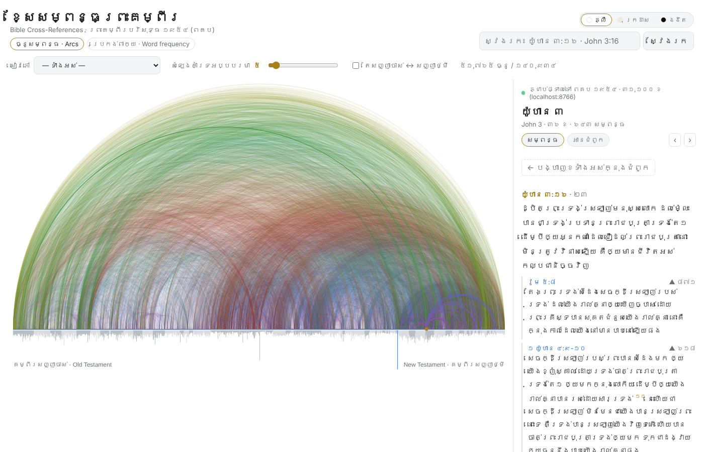

# ខ្សែសម្ពន្ធព្រះគម្ពីរ · Khmer Bible Cross-References

An interactive arc diagram of **341,167 Bible cross-references**, linked live to the Khmer Old Version 1954 — **ព្រះគម្ពីរបរិសុទ្ធ ១៩៥៤ (ពគប)**. Inspired by Chris Harrison & Christoph Römhild's famous cross-reference visualization.

ដ្យាក្រាមធ្នូអន្តរកម្មនៃខគម្ពីរយោង ៣៤១,១៦៧ ភ្ជាប់ផ្ទាល់ទៅអត្ថបទ ពគប ១៩៥៤។



## What it does
- **1,189 chapters** along the axis (Genesis → Revelation); bars below show verses per chapter.
- **140,934 arcs** — one per chapter pair that shares a reference. Colour = distance (magenta = near, green/yellow = far).
- **Hover** a chapter to light up its arcs; **click** to open its references with the Khmer text of both verses.
- **Click a verse** to draw its individual verse-level arcs.
- **Search** in Khmer or English: `យ៉ូហាន ៣:១៦`, `John 3:16`, `រ៉ូម ៨`, `Gen 1`.
- Filters: minimum votes, one book only, Old ↔ New Testament links only.
- Deep links: `…/#John.3.16`, `…/#Ps.23`.
- **Page colour** switch in the header — ភ្លឺ (light, default), ក្រដាស (paper), ងងឹត (dark). The choice is remembered and shared by both pages.

## Word frequency page (`words.html`)
Inspired by Pitch Interactive's Bible/Quran word comparison. Type any Khmer word and see where it appears:
- Every chapter is a row and every verse a cell (Old Testament gold, New Testament orange); verses containing the word light up.
- Occurrences, verses, and the size-adjusted ratio between the testaments, plus a per-book bar chart.
- **Exact word** (ពាក្យពេញ) or **contains** (មានផ្ទុក); several words at once with commas: `អត់ទោស, អភ័យទោស`.
- Khmer-aware matching: zero-width spaces are ignored and `្ដ` / `្ត` count as the same letter, so `សេចក្ដី` and `សេចក្តី` both match.
- Hover a cell to read the verse; click to jump to its cross-reference arcs. Share links like `words.html#q=ស្រឡាញ់&m=word`.

## “Live connection” to ពគប
The Khmer text is **not stored in this repo**. On first visit the browser fetches it in a Web Worker from the [Beblia/Holy-Bible-XML-Format](https://github.com/Beblia/Holy-Bible-XML-Format) GitHub repository (`KhmerBFBSBible.xml`, via jsDelivr with raw.githubusercontent as fallback), then keeps it in the browser cache so later visits are instant. The arcs work immediately even before the text arrives.

To use another source, open the page with `?text=<url-to-xml>` (same Beblia XML format), or edit `TEXT_SOURCES` at the top of `app.js`.

## Publish on GitHub Pages
1. Create a repository (e.g. `khgeo/khmer-bible-arcs`) and push these files to `main`.
2. Settings → Pages → *Deploy from a branch* → `main` / root.
3. Visit `https://khgeo.github.io/khmer-bible-arcs/`.

Run locally: `python3 -m http.server` then open http://localhost:8000.

## Rebuilding the data
```bash
# cross_references.txt: https://www.openbible.info/labs/cross-references/
# KhmerBFBSBible.xml:   https://github.com/Beblia/Holy-Bible-XML-Format
python3 scripts/build_data.py --xref cross_references.txt --bible KhmerBFBSBible.xml --out data
```
The XML is used only for chapter/verse structure. References with zero or negative votes are dropped; 218 that point outside the Khmer versification are skipped.

## Files
| Path | Content |
|---|---|
| `index.html`, `app.js` | Arc diagram page |
| `words.html`, `words.js`, `words.css` | Word frequency page |
| `common.js`, `style.css` | Shared live text loader, helpers and styles |
| `data/meta.json` | Books (Khmer + English names), verses per chapter |
| `data/chapter_links.json` | `[chapterA, chapterB, refCount, maxVotes]` |
| `data/xref/<Book>.json` | Verse-level refs, flat `[from, toStart, toEnd, votes, …]` (global verse indices) |

## Credits & licences
- Cross-references: [OpenBible.info](https://www.openbible.info/labs/cross-references/), **CC-BY**.
- Khmer text: ព្រះគម្ពីរបរិសុទ្ធ ១៩៥៤ (ពគប), Bible Society in Cambodia. The Beblia file marks it © BFBS/UBS 1954, 1962 — the text is loaded from that third-party source, not redistributed here. For a public or institutional deployment, check permission with the Bible Society in Cambodia.
- Code: MIT — YAM Sarath ([@khgeo](https://github.com/khgeo)).
